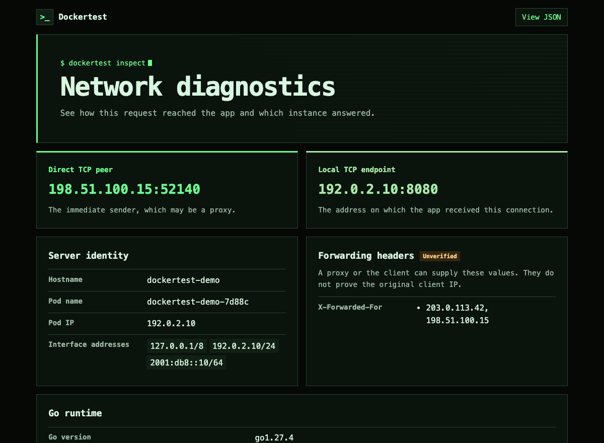

# Dockertest

[](https://github.com/matthiashinrichs/dockertest/actions/workflows/container.yml)
[](https://go.dev/)
[](#container-image)
[](#container-image)

Dockertest is a small Go service for diagnosing HTTP connections in containers
and Kubernetes. It shows which pod handled a request, which TCP endpoints the
app sees, and which client addresses were passed in proxy headers. Use it to
check, for example, whether an ingress forwards the original client IP.



*Terminal dashboard with sample data.*

## Usage

```sh
docker run --rm -p 127.0.0.1:8080:8080 ghcr.io/matthiashinrichs/dockertest:latest
```

Open [localhost:8080](http://localhost:8080) in a browser or request the JSON
report from another terminal:

```sh
curl http://localhost:8080/api/diagnostics
```

- `/` serves the responsive terminal-style dashboard with expandable environment
  values. `/api/diagnostics` returns the same data as JSON. `/healthz` is a
  simple HTTP health check.
- **Hostname and local IPs:** The app displays its hostname and the interface
  addresses it found at startup, including IPv6 and loopback. Optionally, inject
  `POD_NAME` and `POD_IP` through the Kubernetes Downward API using `fieldRef`
  with `metadata.name` and `status.podIP`. The hostname is shown even without
  these variables, but the app does not infer a pod name from it.
- **TCP connection:** The app reports the local endpoint and the direct peer,
  both with port numbers. Behind NAT or a proxy, the peer may not be the
  original client. With `kubectl port-forward`, the local endpoint may be a
  loopback address.
- **Forwarded addresses:** The app displays `Forwarded`, `X-Forwarded-For`,
  `X-Real-IP`, and `X-Original-Forwarded-For` as received and marks them as
  unverified. Whether these headers identify the original client depends on how
  the ingress handles untrusted headers.
- **Go runtime:** Go version, operating system and architecture, logical CPUs
  at startup, current `GOMAXPROCS`, startup time (UTC), and uptime.
- **Environment:** Set `DIAGNOSTICS_ENV_ALLOWLIST` to a comma-separated list of
  exact names, such as `POD_NAMESPACE,NODE_NAME`. The app reads matching
  variables at startup and displays their values without masking. Leave the
  list unset to show no additional environment values. Do not allowlist
  credentials.

Setting `DIAGNOSTICS_ENV_SHOW_ALL=true` overrides the allowlist and displays
the entire process environment in HTML and JSON. In Kubernetes, set it as a
container environment variable. **Enable this only in isolated test
environments:** Tokens, passwords, and other environment secrets will be
visible without masking.

The diagnostics expose internal addresses. Run the app in a suitable test
environment or behind access controls.

## Development

- [`cmd/dockertest/`](./cmd/dockertest/) contains the Go service, tests, and
  embedded HTML template.
- [`docs/`](./docs/) contains documentation images.

Run `go run ./cmd/dockertest` to start the service on port 8080. Use
`go test ./...` to run the tests and `docker build -t dockertest .` to build an
image locally. Pull requests run tests but do not publish images.

## Container image

The [GitHub Actions workflow](./.github/workflows/container.yml) publishes
images to `ghcr.io/matthiashinrichs/dockertest`. Each image contains
`linux/amd64` and `linux/arm64`; Docker selects the right variant when you
pull it. The workflow does not require a separate registry secret.

| Trigger | Image tags |
| --- | --- |
| Push to `master` or manual run on `master` | `edge`, full commit SHA |
| Push of a `vMAJOR.MINOR.PATCH` Git tag | Version tag (e.g. `v0.1.0`), then `latest` after verification |

```sh
docker pull ghcr.io/matthiashinrichs/dockertest:latest
```

Use `edge` instead of `latest` to try the latest build from `master`.
For private packages, run `docker login ghcr.io` first with a classic personal
access token that has `read:packages` and access to the package.
